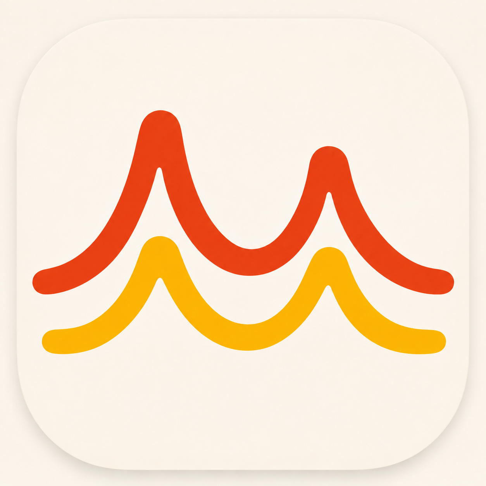
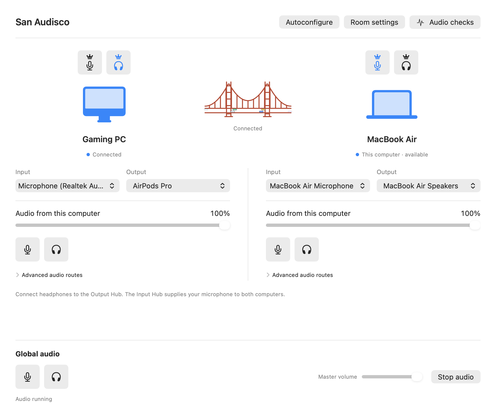
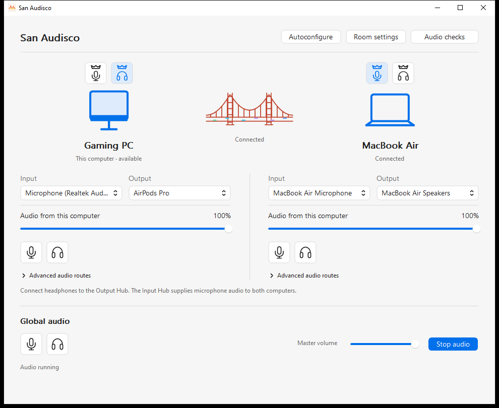

# San Audisco

**Two computers. One place to listen.** Hear audio from both through the same headphones or speakers, and use one microphone across both computers.

## Download

| Your computer | Download v0.4.0 | Open the app |
| --- | --- | --- |
| Windows 10 / 11 · x64 | **[Download for Windows](https://github.com/apopov04/San-Audisco/releases/download/v0.4.0/SanAudisco-Windows-x64.zip)** | Extract the ZIP, then open `SanAudisco.exe`. Keep the extracted files together. |
| Mac · Apple Silicon · macOS 13+ | **[Download for Mac](https://github.com/apopov04/San-Audisco/releases/download/v0.4.0/SanAudisco-macOS-arm64.zip)** | Extract the ZIP, move **San Audisco.app** to Applications, then open it. |

**First time? [Follow the quick setup guide](docs/GETTING_STARTED.md).** These preview downloads contain the app; the required audio components are installed separately. No coding or developer tools needed.

[All downloads and release notes](https://github.com/apopov04/San-Audisco/releases/tag/v0.4.0)

## What can you do with it?

- **Game on your PC, chat on your laptop.** Run Discord on one computer and your game on the other, while hearing both in your headphones.
- **Give your PC a speaker.** Play a video or game on your desktop and hear it through your laptop's built-in speakers.
- **Share one microphone.** Use your preferred microphone for voice apps on both computers, without moving it between them.

Works with **Windows + Mac, Windows + Windows, or Mac + Mac** on the same Wi-Fi or local network. Use headphones or speakers already connected to either computer.

You might ask why I built this. The problem is my PC is running old hardware, and couldn't run Deadlock and Discord at the same time, a problem which is only exacerbated by the fact that my old headphones died and I only had AirPods Pro 3 (My PC also doesn't have speakers). AirPods also have poor audio quality when on handsfree mode (when it relays input and output), so I also had to hear bad quality game audio. This software is the solution to all of these issues.

## How it works

1. Open San Audisco on both computers. **Create a room** on one and enter its code on the other.
2. Choose **where you listen** (the Output Hub) and **which microphone you use** (the Input Hub). They can be different computers.
3. Press **Autoconfigure**, start audio, and unmute when you're ready.

Your headphones stay connected to the computer you listen from. The other computer sends its audio over the network, and San Audisco combines the two.

<table>
  <tr><th>macOS</th><th>Windows</th></tr>
  <tr>
    <td width="50%"></td>
    <td width="50%"></td>
  </tr>
</table>

*Example room on Mac and Windows. Click either screenshot to enlarge.*

Adjust each computer's volume, mute its microphone, or deafen it. The **Global audio** controls apply to both. Changes stay in sync, so you can control the room from either computer.

Stop audio when you're finished; your room is remembered for next time. Quit restores normal audio where the original devices are still available.

## Need a hand?

[Setup and common questions](docs/GETTING_STARTED.md) · [Report a problem](https://github.com/apopov04/San-Audisco/issues) · [Development guide](docs/DEVELOPMENT.md)

San Audisco is a desktop preview for two computers. A small network delay is normal; iPhone support is not included yet.

Open source under the [MIT license](LICENSE). Audio components from other vendors keep their own licenses.
